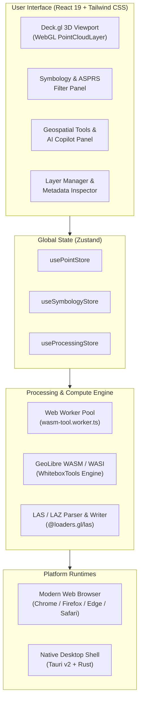

<div align="center">

# 🌐 GeoLibre LiDAR Studio

### Next-Generation 3D Point Cloud Inspection, Analysis & AI-Driven Feature Extraction

[](LICENSE)
[](https://react.dev/)
[](https://www.typescriptlang.org/)
[](https://deck.gl/)
[](https://tauri.app/)
[](https://webassembly.org/)
[](https://vitejs.dev/)

<p align="center">
  A blazing-fast, cross-platform 3D LiDAR visualization and geospatial processing workstation.<br/>
  Runs 100% locally in your browser or as a lightweight native desktop app powered by <b>Tauri v2</b> and <b>WebAssembly</b>.
</p>

</div>

---

## 🌟 Overview

**GeoLibre LiDAR Studio** is an open-source, desktop and web 3D LiDAR processing suite engineered for GIS analysts, surveyors, remote sensing specialists, and data engineers. 

By combining **deck.gl** hardware-accelerated 3D rendering with **GeoLibre WebAssembly (WASI)**, LiDAR Studio allows you to ingest massive LAS/LAZ point clouds, interactively classify structures, plan multi-stage automated pipelines using natural language, and export production-ready datasets—**without requiring heavy desktop GIS software or cloud server dependencies**.

---

## ✨ Key Features

### 🖥️ Ultra-Fast 3D Point Cloud Canvas
- **GPU-Accelerated Rendering**: Smoothly display and navigate millions of points at 60 FPS using `@deck.gl/layers` `PointCloudLayer`.
- **Dynamic Symbology**: Colorize point clouds by **Elevation** (with Turbo, Viridis, Inferno, Elevation, Rainbow, and Plasma ramps), **Intensity**, or **ASPRS Standard Classifications**.
- **Interactive Point Picking**: Click or hover over any point to view instantaneous real-world X/Y/Z coordinates, intensity, return counts, and classification codes.
- **Precision Orbit Controls**: 360° pan, tilt, pitch, and zoom navigation with auto-centering to dataset bounding boxes.

### ⚙️ Client-Side WebAssembly Geospatial Engine
- **Zero-Cloud Compute**: Executes industrial-grade WhiteboxTools spatial algorithms locally via `geolibre-wasm` and background Web Workers.
- **Ground Point Filtering**: Adaptive morphological and local-minima bare earth extraction (`improved_ground_point_filter`).
- **Outlier & Multipath Cleansing**: Spatial density noise filtering (`filter_lidar_noise`).
- **DEM / DTM Generation**: Triangular Irregular Network (TIN) Delaunay interpolation to raster GeoTIFF grids (`lidar_tin_gridding`).
- **Rooftop & Facade Extraction**: RANSAC 3D planar segmentation and geometry isolation (`lidar_ransac_planes`).

### 🤖 AI Pipeline Copilot
- **Natural Language Workflow Planning**: Describe your goal (e.g. *"Clean vegetation, isolate bare earth, and extract all building rooftops"*), and the AI planner synthesizes an ordered, executable processing pipeline.
- **Quick Preset Recipes**: Instant 1-click execution for *Building Extraction*, *Bare Earth DEM*, and *Quality Cleansing*.
- **Real-Time Pipeline Status**: Track step-by-step progress, execution logs, and memory allocation in real time.

### 🎨 ASPRS Standard Classification Management
- **ASPRS Code Filtering**: Full toggle visibility for standard LiDAR classes:
  - `Class 1`: Unassigned
  - `Class 2`: Ground (Bare Earth)
  - `Class 3-5`: Low / Medium / High Vegetation
  - `Class 6`: Building / Rooftop Structures
  - `Class 7`: Low Point (Noise)
  - `Class 9`: Water
  - `Class 18`: High Aerial Noise
- **Custom Elevation Ranging**: Real-time interactive range clamping to highlight vertical slices and structural layers.

### 📁 Streamlined Ingestion & Export
- **Drag-and-Drop Ingestion**: Drop any `.las` or `.laz` file straight into the viewport for instant loading.
- **Built-In Synthetic Benchmark Tile**: Load a 65,000+ point realistic synthetic landscape with rolling terrain, forest canopy, and rooftop geometry with one click.
- **LAS Export**: Save filtered and newly classified point clouds directly back to standardized binary LAS files.

---

## 🏗️ Architecture



---

## 🛠️ Built-In LiDAR Tools

| Tool ID | Category | Name | Output | Purpose |
| :--- | :--- | :--- | :--- | :--- |
| `improved_ground_point_filter` | Classification | **Improved Ground Point Filter** | `.las` | Separates bare-earth terrain from vegetation canopy and above-ground structures. |
| `filter_lidar_noise` | Filtering | **Filter LiDAR Noise** | `.las` | Eliminates high aerial noise, multipath reflections, and isolated spurious points. |
| `lidar_tin_gridding` | Gridding | **TIN DEM Gridding** | `.tif` | Generates continuous Digital Elevation Models from Delaunay triangulation. |
| `classify_lidar` | Features | **Classify LiDAR** | `.las` | Geometric covariance & planarity classification for terrain, vegetation, and buildings. |
| `lidar_ransac_planes` | Features | **RANSAC Planar Rooftops** | `.las` | Fits 3D planes across point clusters to extract architectural rooftops and building envelopes. |

---

## 🚀 Quick Start

### Prerequisites
- [Node.js](https://nodejs.org/) (v18.0.0 or later)
- [npm](https://www.npmjs.com/) (v9 or later)
- *(Optional for Desktop packaging)* [Rust & Cargo](https://rustup.rs/)

### 1. Clone the Repository
```bash
git clone https://github.com/ShinyDataTech/geolibre-lidar-studio.git
cd geolibre-lidar-studio
```

### 2. Install Dependencies
```bash
npm install
```

### 3. Launch the Web App
```bash
npm run dev
```
Open your browser at `http://localhost:5180` to start exploring!

### 4. Run the Desktop App (Tauri v2)
```bash
npm run tauri dev
```

### 5. Build for Production
```bash
# Web bundle build
npm run build

# Tauri native desktop installer (Windows MSI/NSIS, macOS DMG, Linux AppImage/deb)
npm run tauri build
```

---

## 🕹️ Controls & Navigation

| Action | Mouse / Trackpad | Description |
| :--- | :--- | :--- |
| **Rotate / Orbit** | Left Click + Drag | Rotate view around target center in 3D |
| **Pan** | Right Click + Drag *(or Shift + Left Click)* | Pan canvas across horizontal / vertical axes |
| **Zoom** | Scroll Wheel / Pinch | Zoom in and out |
| **Inspect Point** | Hover over point | Displays elevation, coordinates, and ASPRS class |
| **Load Demo Data** | Click **"Load Demo Tile"** | Instantly spawns a synthetic multi-class point cloud |

---

## 📂 Project Structure

```text
geolibre-lidar-studio/
├── src/
│   ├── components/
│   │   ├── layout/         # Application shell (Header, Sidebar, MainLayout)
│   │   ├── panels/         # Symbology, Whitebox tools, AI Studio, Layer Manager
│   │   ├── ui/             # Reusable UI primitives (Buttons, Sliders, Cards, Badges)
│   │   └── viewer/         # Deck.gl 3D canvas and drag-and-drop overlays
│   ├── lib/
│   │   ├── ai/             # AI workflow pipeline planner and prompt presets
│   │   ├── color/          # Color ramps (Turbo, Viridis, etc.) & ASPRS classification maps
│   │   ├── parsers/        # Binary LAS/LAZ reader and writer routines
│   │   ├── store/          # Zustand state management (PointStore, Symbology, Processing)
│   │   └── wasm/           # GeoLibre WASM client, tool registry, and Web Worker runner
│   ├── App.tsx             # Root React component
│   └── main.tsx            # Vite entry point
├── src-tauri/              # Rust Tauri v2 desktop application backend & configuration
├── index.html              # HTML shell with Google Fonts
├── package.json            # Project manifest & scripts
├── tailwind.config.js      # Custom theme & color palette
├── tsconfig.json           # TypeScript configuration
└── vite.config.ts          # Vite build & asset handling configuration
```

---

## 🤝 Contributing

Contributions, feature requests, and issue reports are warmly welcomed!

1. Fork the Project
2. Create your Feature Branch (`git checkout -b feature/AmazingFeature`)
3. Commit your Changes (`git commit -m 'Add some AmazingFeature'`)
4. Push to the Branch (`git push origin feature/AmazingFeature`)
5. Open a Pull Request

---

## 📄 License

Distributed under the **MIT License**. See `LICENSE` for more information.

---

<div align="center">
  <sub>Developed with ❤️ by the <b>GeoLibre & ShinyDataTech</b> team.</sub>
</div>
